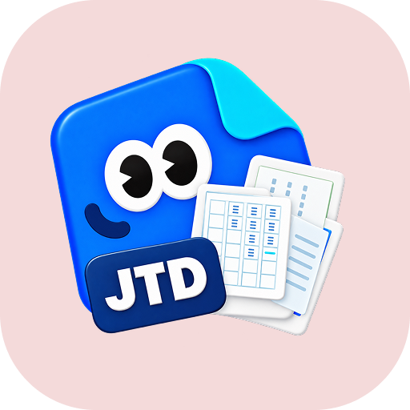
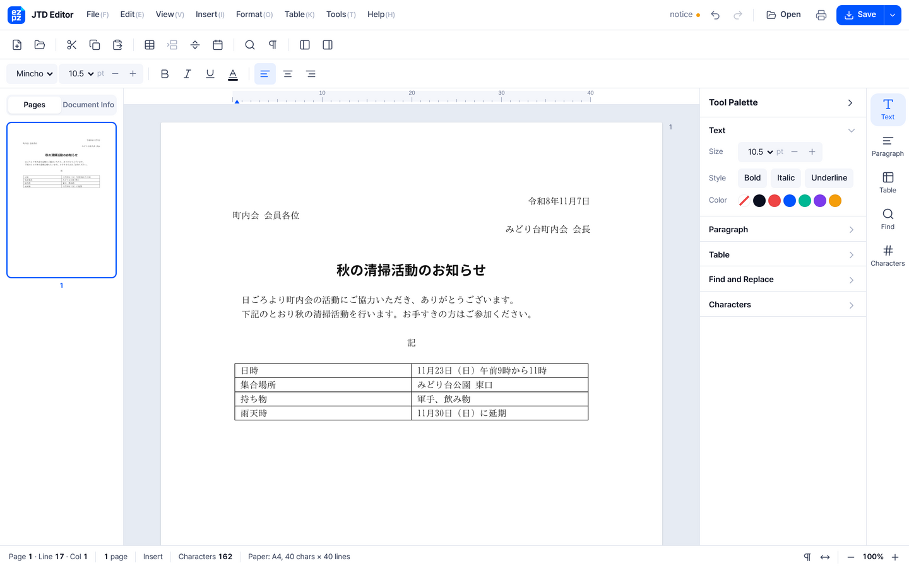
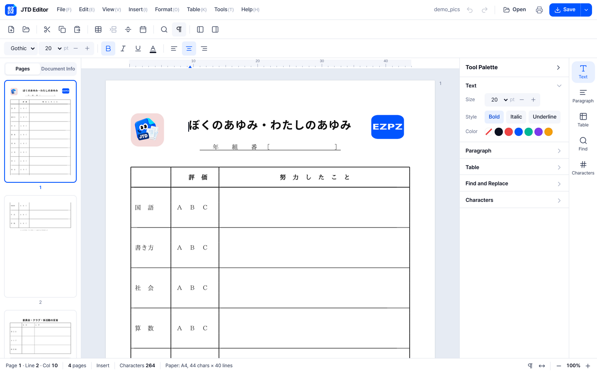
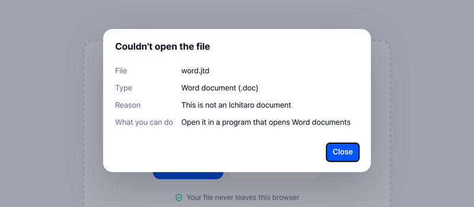
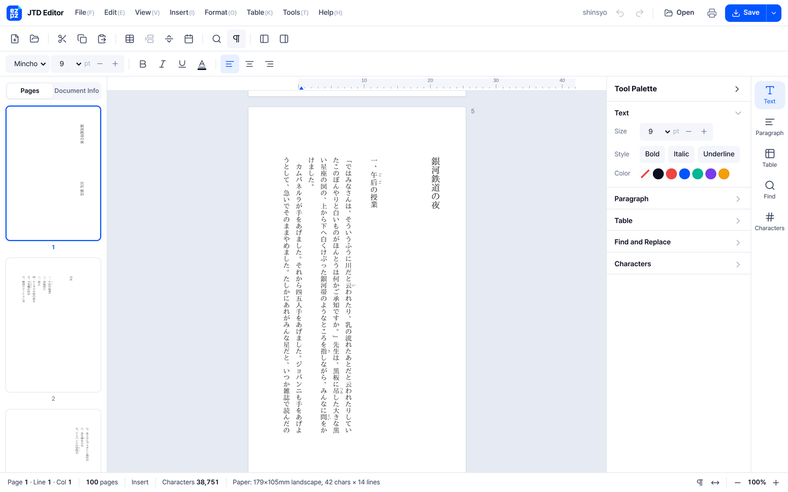

<p align="center">
  
</p>
<h1 align="center">EZPZ File JTD</h1>
<p align="center"><a href="README.md">日本語</a> · <b>English</b> · <a href="README.ko.md">한국어</a></p>
<p align="center">
  <a href="https://ezpzfile.com/jtd-editor"></a>
</p>
<p align="center"><sub>Demo: <a href="https://ezpzfile.com/jtd-editor">English</a> · <a href="https://ezpzfile.com/ja/jtd-editor">日本語</a></sub></p>

**Open Ichitaro (一太郎) `.jtd` documents anywhere: Mac, Linux, phone, browser.**
An open-source reader and format specification for JustSystems Ichitaro files,
in the spirit of [rhwp](https://github.com/edwardkim/rhwp) for HWP. Files never leave your device.

Status: **v0.5.3, reader + editor that saves back to `.jtd` (developer preview).** Not affiliated with JustSystems.

[](https://ezpzfile.com/jtd-editor)

<sub>A made-up neighbourhood notice open in the browser editor (a document made with this engine).</sub>

<table>
<tr>
<td width="50%"><a href="https://ezpzfile.com/jtd-editor"></a></td>
<td width="50%"><a href="https://ezpzfile.com/jtd-editor"></a></td>
</tr>
<tr>
<td><sub><b>Pictures (0.4.4)</b>: photos and illustrations in a document, where Ichitaro Viewer puts them (pictures swapped for this sample)</sub></td>
<td><sub><b>When a file does not open (0.4.0)</b>: what the file is, why, and what you can do</sub></td>
</tr>
<tr>
<td colspan="2"><a href="https://ezpzfile.com/jtd-editor"></a></td>
</tr>
<tr>
<td colspan="2"><sub><b>Vertical writing (0.4.6)</b>: <i>Night on the Galactic Railroad</i> (Kenji Miyazawa, public domain) in a novel template, with ruby to the right of the column</sub></td>
</tr>
</table>

### Recent releases

| Version | What changed |
|---|---|
| 0.5.3 | B4 landscape **columns split into top and bottom halves** (text runs top left, top right, bottom left, bottom right; frames fixed on the page are measured from their half). Empty lines no longer move round frames, a text box across the whole column pushes the text below it, and lines with ruby or 16 pt characters stay one line tall |
| 0.5.2 | Text box **shadows** (solid and dotted), **fills** (one colour and gradients), inner margins and line spacing matched to Ichitaro Viewer. When 行数 and 行間 disagree by more than twice, 行間 wins |
| 0.5.1 | Text box **frame lines** (dotted, solid, rounded), figure **dot fills** and gradients, figures placed inside text boxes. Body text goes round photos and narrows beside text boxes (as in Ichitaro Viewer). **Word export carries figures** (SVG) |
| 0.5.0 | **Figures** (illustrations, balloons, ellipses and rounded frames, staves) and **art text and drawings from other programs** such as Hanako (their OLE previews) now show. A two-column B4 school handout comes out close to Ichitaro Viewer |
| 0.4.9 | Body text now **goes round** text boxes and photos (回り込み) instead of running under them; frames fixed to the page are placed from the paper's top left |
| 0.4.8 | **Fonts**: the font names the document uses are listed as they are; pick one and it is saved to `.jtd`. Rounded Gothic, textbook, brush and pop faces are drawn with similar free fonts. **Text box** text, **columns** (段組), tight line spacing and pictures on ruled lines now show. **Word export carries pictures** and font names |
| 0.4.7 | With input methods that report every key to the IME (Korean and others), Backspace, Delete and arrows work again and syllables no longer fall apart into letters; tidier tool palette whose buttons no longer wrap |
| 0.4.6 | **Vertical writing** shown and edited vertically (kanji and kana upright, 、。 at the top right, long vowels and brackets turned); Word export writes it vertically too |
| 0.4.5 | No stray marks next to pictures; new screenshots |
| 0.4.4 | Pictures (GIF, JPEG, PNG, BMP) drawn where they sit; also in PDF export |
| 0.4.3 | `.jtdc` compressed documents in the open dialog; checked on 17 real files |
| 0.4.2 | Choose Mincho or Gothic and save it to `.jtd` |
| 0.4.1 | Documents with a page break just before a ruled box save as `.jtd` |
| 0.4.0 | Compressed Ichitaro files (`.jttc`, `.jtdc`), help when a file does not open, Gothic text |

Every change is in [Releases](https://github.com/ezpzfile/ezpzfile-jtd/releases).

## Use it in your browser (no install)

We run free tools built directly on this engine. Your files never leave your device.

- [JTD editor](https://ezpzfile.com/jtd-editor): open a .jtd, edit it, and save it back in Ichitaro format. Converts to Word and PDF too
- [How to open a .jtd file without Ichitaro](https://ezpzfile.com/column/open-jtd-file)

### Sites using this engine

- [KUKAN](https://github.com/kukan-project/kukan): an open data catalog for government agencies. Uses it to preview Ichitaro documents
- [openedfile.com](https://openedfile.com/ja/tools/jtd): a tool to open and convert .jtd files in the browser

Using it somewhere? Let us know and we will add you here.

## What works

Tested on public Ichitaro files published by Japanese ministries and others (Ichitaro 8 to the latest): a base set of 95 and a second set of 111 with pictures, vertical writing, large documents and more.

**Opening**

- all 95 of the base set open; about 2 ms per file
- body text: 99.9 % of the visible characters match what **Ichitaro Viewer itself** shows
  (87 of 94 files identical), checked automatically with JustSystems' free viewer
- **compressed Ichitaro files** (`.jttc` templates, `.jtdc` documents): the document inside is unpacked and opened
  (LHA `-lh5-`). All 17 real public files open, and `.jtdc` text matches Ichitaro Viewer at 99.2 %
- large documents of around 100 pages (text stored in several pieces) open and save as `.jtd`
- telling what a file is when it does not open (Word, PDF, RTF, text, …: `sniff::kind`, WASM `fileKind`);
  the editor opens RTF or text saved under a `.jtd` name as a new document (text only)

**Showing**

- paragraphs, alignment, indents, line feed (改行幅)
- ruled tables (merged cells, column widths, vertical and **horizontal rules**, rules between lines or through them, the 16 **line types**: thick, dotted, double and so on)
- page setup: **paper size and orientation, margins, characters per line and lines per page**, base character size
- font size, bold, italic, underline, colour, ruby (furigana), page breaks
- typefaces: Mincho, Gothic, rounded Gothic, textbook, brush and pop (by the document's font names; free look-alikes on ezpzfile.com)
- **vertical writing** (縦組み): lines run top to bottom and follow each other right to left; kanji and kana stand upright, 、。 sit at the top right, long vowels, brackets and half-width text turn; arrow keys follow the vertical direction
- **pictures**: GIF, JPEG, PNG and BMP pictures drawn where they sit on the page (`/Frame` frames and anchors in the text, checked against Ichitaro Viewer)
- document properties, including the **original file path** that Ichitaro leaves inside files

**Editing and saving**

- edited files **save back to `.jtd`**, and Ichitaro Viewer opens them (see below); pictures stay
- choose any font of the document (or a usual Ichitaro one) and save it to `.jtd`
- text box text, columns (段組) and pictures on ruled lines are shown
- export: Word (`.docx`), PDF, HTML, plain text, Markdown, JSON

**Not yet**: editing figures and text boxes, text box direction (vertical
boxes), headers and footers, Ichitaro 7 and earlier formats (`.jaw`, `.jbw`, …). See the
[roadmap](docs/PLAN.en.md) ([日本語](docs/PLAN.ja.md), [한국어](docs/PLAN.ko.md)).

## Editor

`web/dist/ezpzjtd-editor.html` is a word processor in one file: double-click it, drop a
`.jtd` on the window (or start a new document), edit, and save as **Ichitaro (.jtd)** /
Word / PDF / HTML / text. Like rhwp-studio, the engine lays out and draws the pages itself (canvas); the
browser only supplies keys, the Japanese input method and the screen.

The screen and keys follow Ichitaro so its users feel at home: menu bar with a 罫線
menu, toolbar, jump palette (pages, document info) on the left, tool palette on the
right, ruler in 字 units, status bar with `nページ n行 n字` and 挿入/上書, editing
marks (改行マーク, □ for full-width spaces), and Ichitaro shortcuts (Ctrl+5/6
center/right, Ctrl+↑/↓ size, Ctrl+Y page break, Ctrl+¥ table, F7 font, Ctrl+2 save as,
Esc menu, and a Windows / Ichitaro key-map switch for Ctrl+F). No JustSystems artwork
is used.
The screen comes in Japanese and English: `web/dist/ezpzjtd-editor.en.html` is the
English one, and `?lang=en` / `?lang=ja` switches either file. To use it right away in a
browser: [ezpzfile.com/jtd-editor](https://ezpzfile.com/jtd-editor). To put it on a site,
use `web/dist/ezpzjtd-editor.embed.html` with the URL of the `.wasm` from `web/pkg/`
filled in. Opened in a frame of a page on the same site, it talks to that page as
`web/editor/host.js` describes. Details: [docs/EDITOR.en.md](docs/EDITOR.en.md)
([日本語](docs/EDITOR.ja.md), [한국어](docs/EDITOR.ko.md)).

### Saving as `.jtd`

A document opened from a `.jtd` saves back to `.jtd` (Ctrl+S). The engine does not
regenerate the file: it **patches the original**, so everything it does not understand
yet (ruled-line geometry, hidden fields, macros, pictures) stays byte for byte. Text,
paragraphs, bold / italic / size / underline / colour, alignment, indents and line feed, page
breaks and table lines are written (a new row keeps the line types of the row it
copies). Every save is read back and compared with the editor; if anything differs
the save is refused with a reason and nothing is written (then use Word or PDF).

**New documents** save as `.jtd` too. They are written into an empty Ichitaro file with the
page a new Ichitaro document gets (A4, 30 mm margins, 40 × 40 characters, 10.5 pt):
`engine/crates/ezpzjtd-core/src/blank.jtd`, made from a public Ichitaro file with its text,
author, dates and original file path taken out (`examples/makeblank.rs` shows how). Text,
formatting, tables and page breaks typed into a new document open in Ichitaro Viewer.

Checked with JustSystems' own Ichitaro Viewer 2022, run automatically through Wine
([tools/taroview](tools/taroview/README.md)): see [experiments/results.md](experiments/results.md) (in Korean).
We also check with **the latest 一太郎 itself** (run through Wine,
[tools/taro2026](tools/taro2026/README.md)): all 274 files saved by the editor open in it,
and a new table draws its vertical and horizontal rules like a table made in Ichitaro. See
[docs/research/ichitaro-latest.md](docs/research/ichitaro-latest.md).

### PDF

Save as PDF writes the pages exactly as drawn on screen, with an invisible text layer
so the PDF can still be searched and copied.

## Try it

**Browser (no install):** build once, then double-click `web/dist/ezpzjtd-editor.html`
(editor) or `web/dist/ezpzjtd-viewer.html` (viewer) and drop a `.jtd` file on it.
Both work offline.

```sh
./web/build.sh
```

**Command line:**

```sh
cd engine
cargo run --release -p ezpzjtd-cli -- text  sample.jtd      # plain text
cargo run --release -p ezpzjtd-cli -- html  sample.jtd > sample.html
cargo run --release -p ezpzjtd-cli -- md    sample.jtd      # Markdown
cargo run --release -p ezpzjtd-cli -- json  sample.jtd      # document model
cargo run --release -p ezpzjtd-cli -- info  sample.jtd      # properties, fonts, sheets
```

Also `ezpzjtd docx <file> <out.docx>`. Research commands: `streams`, `dump <path>`, `tokens`, `styles`,
`experiment <file> <dir>` (variants for checking in Ichitaro Viewer).

**As a library (Rust):**

```rust
let doc = ezpzjtd_core::open(std::fs::read("sample.jtd")?)?;
println!("{}", doc.plain_text());
let html = ezpzjtd_core::export::to_html(&doc);
```

**As a library (JavaScript / WebAssembly):** `web/pkg/` after `./web/build.sh`.

```js
import init, { JtdDocument } from "./pkg/ezpzjtd_wasm.js";
await init();
const doc = new JtdDocument(new Uint8Array(await file.arrayBuffer()));
element.innerHTML = doc.html();
```

### Opening untrusted files

A `.jtd` carries its own length and count fields. When a crafted file claims more than it holds, the engine
does not trust it: every count is checked against the bytes that are really there, and reading stops at
these limits (the defaults are far above any real document).

| Limit | Default | When exceeded |
|---|---|---|
| `maxBytes` | 256 MB | "too large or damaged" error |
| `maxTextUnits` | 8 million | same |
| `maxExpand` | 4 × the file | text streams together larger than this: same |
| `maxStyleEntries` | 2 million | style properties kept for all changes of character style together: same (0.3.3) |
| `maxSheets` | 64 | further sheets skipped with a warning |
| `maxPages` | 2,000 | layout stops there (`statusJson().truncated`) |

When you embed the engine in another service, lower the limits and run it in a Web Worker.
`web/worker/ezpzjtd-safe.js` does that for you and terminates the worker on a timeout.

```js
import { readJtdSafely } from "./worker/ezpzjtd-safe.js";
const { result } = await readJtdSafely(bytes, { want: "html", limits: { maxPages: 300 }, timeoutMs: 10000 });
// or directly: JtdDocument.withLimits(bytes, '{"maxPages":300}') / JtdEditor.openWith(bytes, '{"maxPages":300}')
```

In Rust: `ezpzjtd_core::open_with(bytes, &Limits { max_pages: 300, ..Default::default() })`.

## The format

[`docs/spec/JTD-FORMAT.md`](docs/spec/JTD-FORMAT.md) is the working specification.
Every statement is tagged *confirmed / strong / observed / candidate / unknown*.

How we decode it without Ichitaro: Japanese public bodies often publish the same
form as `.jtd` **and** `.doc`. Word's formatting is known, so lining the two files
up character by character tells us what each unknown JTD field means.
`tools/research/` holds those scripts.

Since v0.3 we also use **JustSystems' free Ichitaro Viewer as a referee**: files we
change are opened in the real viewer (Wine, Japanese locale) and their text is
copied back out and compared. That is how we found the per-storage stream directory
(`\x04JSRV_SegmentInformation`) that must match every stream size.

## Repository

```
engine/                Rust workspace
  crates/ezpzjtd-core    reader (CFB → block store → records → styles → model),
                       editor (edit, layout on the 字×行 grid), exporters (docx, pdf, html, md),
                       writer (save.rs: patch the original; cfbw.rs: CFB writer)
  crates/ezpzjtd-cli     `ezpzjtd` command
  crates/ezpzjtd-wasm    WebAssembly bindings
web/                   browser editor (editor.html + editor/app.js) and viewer, built to single files
docs/spec/             format specification
docs/PLAN.*.md         roadmap; docs/EDITOR.*.md editor design (日本語, English, 한국어)
docs/research/         research notes and sample-making guides
tools/                 corpus download and research scripts
tools/taroview/        open files in the real Ichitaro Viewer (Wine) and read back what it shows
tools/taro2026/        make paired samples with the latest 一太郎 (Wine) and open saved files in it
experiments/           notes and results of the viewer checks
corpus/manifest.tsv    URLs of public sample files (files themselves are not committed)
```

## Contributing

The most valuable contribution is **paired samples**: the same document saved twice
from Ichitaro with one setting changed. See
[`docs/research/paired-samples.en.md`](docs/research/paired-samples.en.md).
Please do not commit documents you do not have the right to share.

```sh
python3 tools/fetch_corpus.py --docx   # public corpus → corpus/local/
cd engine && EZPZJTD_CORPUS=$PWD/../corpus/local cargo test
```

## Thanks

Built on the published research of [OpenJTD](https://github.com/KimEJ/OpenJTD) and
[Tika-JTD](https://github.com/KHiyowa/Tika-JTD). See [NOTICE](NOTICE).

The memory problems fixed in 0.3.2 and 0.3.3 (a crafted file could make memory use and page count grow
without end; style properties were copied for every style change and every character) were reported privately
by HIDANO Masaki of [KUKAN](https://github.com/kukan-project/kukan). Thank you.

## License

MIT License ([LICENSE](LICENSE)). You may use, change, share and sell it freely. Keep the copyright notice
"Copyright (c) 2026 EZPZ File (https://ezpzfile.com)" and the licence text in copies and changed versions.
If you use it in a service or product, a "Powered by EZPZ File" credit somewhere would be appreciated (optional).
"一太郎" / "Ichitaro" are trademarks of JustSystems Corporation.
