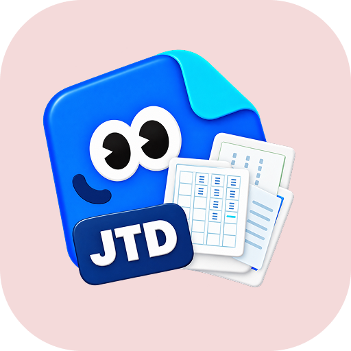
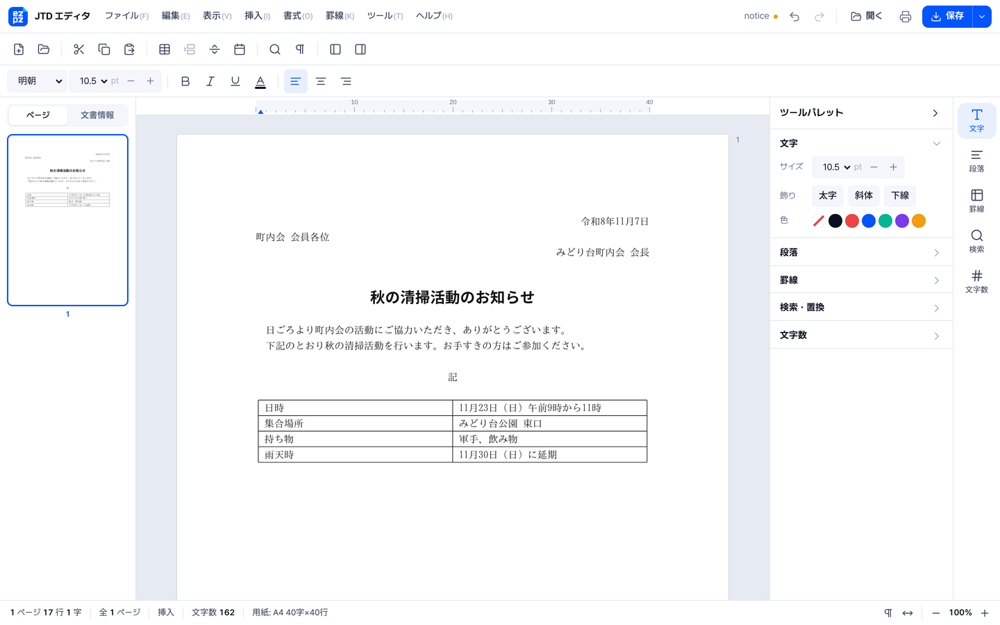
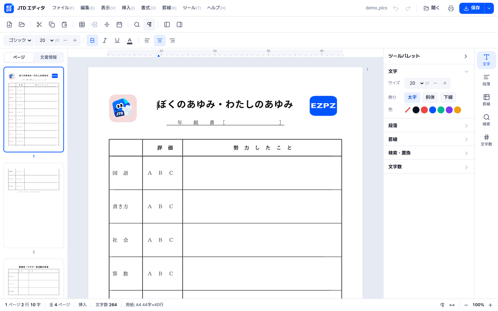
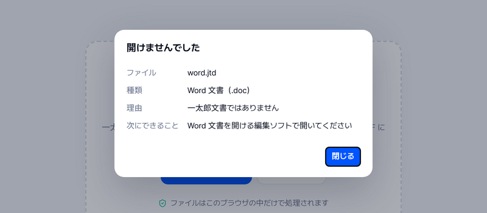
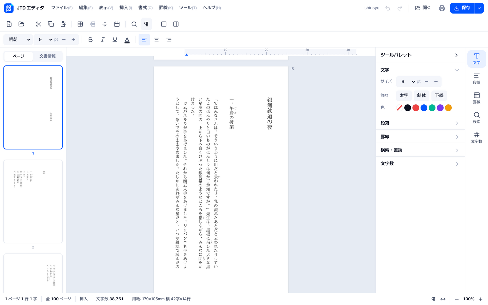

<p align="center">
  
</p>
<h1 align="center">EZPZ File JTD</h1>
<p align="center"><a href="README.md">日本語</a> · <a href="README.en.md">English</a> · <b>한국어</b></p>
<p align="center">
  <a href="https://ezpzfile.com/ja/jtd-editor"></a>
</p>
<p align="center"><sub>데모: <a href="https://ezpzfile.com/ja/jtd-editor">日本語</a> · <a href="https://ezpzfile.com/jtd-editor">English</a></sub></p>

**일본 워드프로세서 一太郎(이치타로)의 `.jtd` 문서를 맥·리눅스·휴대폰·브라우저에서 열고 고쳐서 저장.**
저스트시스템 一太郎 파일을 다루는 오픈소스 읽기 엔진·편집기·파일 형식 규격서입니다.
HWP의 [rhwp](https://github.com/edwardkim/rhwp)와 같은 생각으로 만들었고 파일은 기기 밖으로 보내지 않습니다.

상태: **v0.4.6. `.jtd`로 다시 저장하는 읽기 엔진 + 편집기(개발자 미리보기).** 저스트시스템과는 관계없습니다.

[](https://ezpzfile.com/ja/jtd-editor)

<sub>가상의 동네 모임 안내문을 브라우저 편집기로 연 모습(이 엔진으로 만든 문서).</sub>

<table>
<tr>
<td width="50%"><a href="https://ezpzfile.com/ja/jtd-editor"></a></td>
<td width="50%"><a href="https://ezpzfile.com/ja/jtd-editor"></a></td>
</tr>
<tr>
<td><sub><b>그림 표시(0.4.4)</b>: 문서에 넣은 사진과 삽화를 一太郎ビューア와 같은 자리에 표시(견본용으로 그림을 바꿈)</sub></td>
<td><sub><b>열리지 않는 파일 안내(0.4.0)</b>: 무슨 파일인지, 왜 안 열리는지, 다음에 할 일을 표시</sub></td>
</tr>
<tr>
<td colspan="2"><a href="https://ezpzfile.com/ja/jtd-editor"></a></td>
</tr>
<tr>
<td colspan="2"><sub><b>세로쓰기(0.4.6)</b>: 문예서 서식에 담긴 『은하철도의 밤』(미야자와 겐지, 저작권 만료). 루비도 세로줄 오른쪽에 표시</sub></td>
</tr>
</table>

### 최근 변경

| 판 | 내용 |
|---|---|
| 0.4.6 | **세로쓰기** 문서를 세로로 표시·편집(한자·가나는 바로 세우고, 、。는 오른쪽 위, 장음·괄호는 돌림). Word 내보내기도 세로쓰기 |
| 0.4.5 | 그림 옆에 나오던 작은 기호를 표시하지 않음. README 화면 새로 찍음 |
| 0.4.4 | 문서에 넣은 그림(GIF·JPEG·PNG·BMP)을 원래 자리에 표시. PDF 내보내기에도 들어감 |
| 0.4.3 | 압축 문서 `.jtdc`를 열기 창에서 고를 수 있음. 실제 파일 17개로 확인 |
| 0.4.2 | 명조·고딕을 골라 `.jtd`로 저장 |
| 0.4.1 | 괘선 틀 바로 앞에 쪽 나눔이 있는 문서를 `.jtd`로 저장 |
| 0.4.0 | 압축된 一太郎 파일(`.jttc`·`.jtdc`) 열기, 열리지 않는 파일 안내, 고딕 표시 |

모든 변경은 [Releases](https://github.com/ezpzfile/ezpzfile-jtd/releases)에 있습니다.

## 브라우저에서 바로 쓰기 (설치 없음)

이 엔진을 그대로 넣은 무료 도구를 운영합니다. 파일은 기기 밖으로 나가지 않습니다. 화면은 일본어와 영어만 있습니다.

- [JTD 편집기](https://ezpzfile.com/jtd-editor): .jtd 를 열어 고치고 一太郎 형식 그대로 저장. Word·PDF 로도 변환
- [一太郎 없이 jtd 파일 여는 법 (영어)](https://ezpzfile.com/column/open-jtd-file)

### 이 엔진을 쓰는 곳

- [KUKAN](https://github.com/kukan-project/kukan): 일본 관공서 오픈 데이터 카탈로그. 一太郎 문서 미리 보기에 사용
- [openedfile.com](https://openedfile.com/ja/tools/jtd): jtd 를 브라우저에서 열고 변환하는 도구

쓰고 계신 곳이 있으면 알려 주세요. 여기에 더하겠습니다.

## 되는 것

일본 관공서 등이 인터넷에 공개한 一太郎 파일로 확인했습니다(一太郎 8부터 최신판까지. 기본 묶음 95개와, 그림·세로쓰기·큰 문서 등이 든 추가 묶음 111개).

**열기**

- 기본 묶음 95개 모두 열림. 파일당 약 2ms
- 본문: 보이는 글자의 99.9%가 **一太郎ビューア 자체**가 보여 주는 것과 같음(94개 중 87개 완전 일치).
  저스트시스템의 무료 뷰어로 자동 확인
- **압축된 一太郎 파일**(`.jttc` 압축 서식, `.jtdc` 압축 문서): 안의 문서를 풀어서 엶(LHA `-lh5-` 방식).
  공개된 실제 파일 17개가 모두 열리고, `.jtdc` 본문은 一太郎ビューア와 99.2% 일치
- 100쪽 안팎의 큰 문서(본문이 여러 조각으로 나뉜 형식)도 열고 `.jtd`로 저장
- 열리지 않는 파일 판별: Word·PDF·RTF·텍스트 등 무슨 파일인지 알려 줌(`sniff::kind`, WASM `fileKind`).
  이름만 `.jtd`인 RTF·텍스트는 편집기가 글자만 새 문서로 엶

**보이기**

- 문단과 정렬, 들여쓰기, 줄 간격(改行幅)
- 괘선 표(합친 칸, 칸 너비, 세로 괘선과 **가로 괘선**, 줄 사이 괘선·줄 가운데 괘선, **선 종류** 16가지: 굵은 선, 점선, 이중선 등)
- 문서 스타일: **용지 크기와 방향, 여백, 한 줄 글자 수와 쪽당 줄 수**, 기본 글자 크기
- 글자 크기, 굵게, 기울임, 밑줄, 글자색, 루비(후리가나), 쪽 나눔
- 글꼴: 명조와 고딕(문서의 글꼴 표로 판단)
- **세로쓰기**(縦組み): 줄은 위에서 아래로, 오른쪽에서 왼쪽으로. 한자·가나는 바로 세우고 、。는 오른쪽 위, 장음·괄호·반각 글자는 돌림. 화살표 키도 세로쓰기 방향으로 움직임
- **그림**: 문서에 넣은 GIF·JPEG·PNG·BMP를 쪽의 원래 자리에 표시(`/Frame` 틀과 본문 기준점, 一太郎ビューア와 대조)
- 문서 정보. 一太郎가 파일 안에 남기는 **원래 저장 경로**도 표시

**고쳐서 저장하기**

- 편집한 파일을 **`.jtd`로 다시 저장**하고 一太郎ビューア에서 열림(아래 참고). 그림도 남음
- 명조·고딕을 골라 `.jtd`로 저장(글꼴 표에 ＭＳ ゴシック 추가)
- 내보내기: Word(`.docx`), PDF, HTML, 텍스트, Markdown, JSON

**아직 안 되는 것**: 도형·글상자, Word 내보내기의 그림, 머리글·바닥글, 다단(段組),
一太郎 Ver.7 이전 형식(`.jaw`, `.jbw` 등). 자세한 내용은 [기획서](docs/PLAN.ko.md)([日本語](docs/PLAN.ja.md), [English](docs/PLAN.en.md)).

## 편집기

`web/dist/ezpzjtd-editor.html` 한 파일이 워드프로세서 전체입니다. 더블클릭해서 열고 `.jtd`를 창에
끌어다 놓거나 새 문서로 시작해서 편집한 뒤, **一太郎(.jtd)**·Word·PDF·HTML·텍스트로 저장합니다.
rhwp-studio처럼 쪽 배치와 그리기는 엔진이 직접 합니다(canvas). 브라우저는 키 입력, 일본어 입력기(IME),
화면만 맡습니다.

화면과 키는 一太郎에 맞춰서 一太郎 사용자가 바로 쓸 수 있습니다. 罫線 메뉴가 있는 메뉴바, 도구 막대,
왼쪽 점프팔레트(쪽, 문서 정보), 오른쪽 툴팔레트, 字 단위 눈금자, `nページ n行 n字`와 挿入/上書가 나오는
상태표시줄, 편집 기호(改行マーク, 전각 공백은 □), 一太郎 단축키(Ctrl+5/6 가운데/오른쪽, Ctrl+↑/↓ 글자 크기,
Ctrl+Y 쪽 나눔, Ctrl+¥ 표, F7 글꼴, Ctrl+2 다른 이름으로 저장, Esc 메뉴, Ctrl+F의 Windows형 / 一太郎형 전환).
저스트시스템의 그림이나 아이콘은 쓰지 않습니다.
화면 글은 일본어와 영어가 있습니다. 영어판은 `web/dist/ezpzjtd-editor.en.html`이고, 어느 파일이든
`?lang=en` / `?lang=ja`로 바꿀 수 있습니다. 브라우저에서 바로 쓰려면 [ezpzfile.com/jtd-editor](https://ezpzfile.com/jtd-editor).
다른 사이트에 올릴 때는 `web/dist/ezpzjtd-editor.embed.html`에 `web/pkg/`의 `.wasm` 주소를 넣어 씁니다.
같은 사이트의 틀(iframe) 안에서 열리면 `web/editor/host.js`에 적힌 약속대로 그 쪽과 말을 주고받습니다.
자세한 내용은 [docs/EDITOR.ko.md](docs/EDITOR.ko.md)([日本語](docs/EDITOR.ja.md), [English](docs/EDITOR.en.md)).

### `.jtd`로 저장

`.jtd`에서 연 문서는 `.jtd`로 다시 저장됩니다(Ctrl+S). 엔진은 파일을 새로 만들지 않고 **원본을 고쳐 씁니다**.
그래서 아직 못 푼 부분(괘선 좌표, 숨은 필드, 매크로, 그림)은 1바이트도 바뀌지 않습니다. 고쳐 쓰는 것은 글자,
문단, 굵게·기울임·크기·밑줄·색, 정렬, 들여쓰기·줄 간격, 쪽 나눔, 표 줄입니다(새 줄은 복사한 줄의 선 종류를
이어받습니다). 저장할 때마다 결과를 다시 읽어 편집기 내용과 비교하고
다르면 이유를 보여 주고 저장하지 않습니다(아무것도 쓰지 않음. 그때는 Word나 PDF로 저장).

**새 문서**도 `.jtd`로 저장됩니다. 一太郎 새 문서와 같은 쪽(A4, 여백 30mm, 40자 × 40줄, 10.5pt)의
빈 一太郎 파일(`engine/crates/ezpzjtd-core/src/blank.jtd`)에 써 넣습니다. 이 빈 파일은 공개된 一太郎 파일에서
본문, 작성자, 날짜, 원래 저장 경로를 빼서 만들었습니다(만드는 방법은 `examples/makeblank.rs`).
새 문서에 입력한 글자·서식·표·쪽 나눔이 一太郎ビューア에서 열리는 것을 확인했습니다.

확인은 저스트시스템의 一太郎ビューア 2022를 Wine에서 자동으로 돌려서 합니다
([tools/taroview](tools/taroview/README.md)). 결과는 [experiments/results.md](experiments/results.md).
**一太郎 최신판 본체**(Wine에서 실행, [tools/taro2026](tools/taro2026/README.md))로도 확인합니다.
편집기로 고쳐 저장한 파일 274개가 모두 一太郎 최신판에서 열렸고, 새로 만든 표도 一太郎에서 만든 표처럼
세로선과 가로선이 그려집니다. 자세한 내용은 [docs/research/ichitaro-latest.md](docs/research/ichitaro-latest.md)(영어).

### PDF

PDF로 저장하면 화면에 그린 그대로 쪽을 쓰고 보이지 않는 글자층을 겹칩니다. 그래서 PDF에서도 글자를
검색하고 복사할 수 있습니다.

## 써 보기

**브라우저(설치 없음):** 한 번 빌드한 뒤 `web/dist/ezpzjtd-editor.html`(편집기)이나
`web/dist/ezpzjtd-viewer.html`(뷰어)을 더블클릭하고 `.jtd` 파일을 끌어다 놓습니다. 둘 다 인터넷 없이 됩니다.

```sh
./web/build.sh
```

**명령줄:**

```sh
cd engine
cargo run --release -p ezpzjtd-cli -- text  sample.jtd      # 텍스트
cargo run --release -p ezpzjtd-cli -- html  sample.jtd > sample.html
cargo run --release -p ezpzjtd-cli -- md    sample.jtd      # Markdown
cargo run --release -p ezpzjtd-cli -- json  sample.jtd      # 문서 모델
cargo run --release -p ezpzjtd-cli -- info  sample.jtd      # 문서 정보, 글꼴, 시트
```

그 밖에 `ezpzjtd docx <file> <out.docx>`. 분석용 명령: `streams`, `dump <path>`, `tokens`, `styles`,
`experiment <file> <dir>`(一太郎ビューア로 확인할 변형 파일 만들기).

**라이브러리로(Rust):**

```rust
let doc = ezpzjtd_core::open(std::fs::read("sample.jtd")?)?;
println!("{}", doc.plain_text());
let html = ezpzjtd_core::export::to_html(&doc);
```

**라이브러리로(JavaScript / WebAssembly):** `./web/build.sh` 뒤의 `web/pkg/`.

```js
import init, { JtdDocument } from "./pkg/ezpzjtd_wasm.js";
await init();
const doc = new JtdDocument(new Uint8Array(await file.arrayBuffer()));
element.innerHTML = doc.html();
```

### 믿을 수 없는 파일을 열 때

`.jtd` 안에는 길이·개수를 적는 칸이 있습니다. 조작된 파일이 실제보다 큰 값을 적어도 엔진은 그대로 믿지 않고,
실제로 있는 바이트 수와 아래 상한에서 멈춥니다(기본값은 실제 문서보다 훨씬 큽니다).

| 상한 | 기본값 | 넘으면 |
|---|---|---|
| `maxBytes` | 256 MB | "too large or damaged" 오류 |
| `maxTextUnits` | 800만 자 | 같음 |
| `maxExpand` | 파일의 4배 | 본문 스트림 합계가 이보다 크면 같음 |
| `maxStyleEntries` | 200만 | 글자 서식이 바뀔 때마다 보관하는 속성 수의 합이 이보다 크면 같음(0.3.3) |
| `maxSheets` | 64 | 그 뒤 시트는 읽지 않고 경고 |
| `maxPages` | 2,000 | 거기서 배치를 멈춤(`statusJson().truncated`) |

다른 서비스에 넣어 쓸 때는 상한을 낮추고 Web Worker 안에서 돌리세요. `web/worker/ezpzjtd-safe.js` 가
그렇게 해 주고, 시간을 넘기면 Worker 를 통째로 멈춥니다.

```js
import { readJtdSafely } from "./worker/ezpzjtd-safe.js";
const { result } = await readJtdSafely(bytes, { want: "html", limits: { maxPages: 300 }, timeoutMs: 10000 });
// 직접 부르려면: JtdDocument.withLimits(bytes, '{"maxPages":300}') / JtdEditor.openWith(bytes, '{"maxPages":300}')
```

Rust 에서는 `ezpzjtd_core::open_with(bytes, &Limits { max_pages: 300, ..Default::default() })`.

## 파일 형식

[`docs/spec/JTD-FORMAT.md`](docs/spec/JTD-FORMAT.md)(영어)가 작업 중인 규격서입니다.
모든 내용에 *confirmed / strong / observed / candidate / unknown* 확실도를 붙였습니다.

一太郎 없이 푸는 방법: 일본 관공서는 같은 양식을 `.jtd`**와** `.doc`로 함께 올리는 경우가 많습니다.
Word 쪽 서식은 알고 있으니, 두 파일을 글자 단위로 맞대 보면 jtd의 모르는 항목이 무슨 뜻인지 알 수 있습니다.
그 스크립트는 `tools/research/`에 있습니다.

v0.3부터는 **저스트시스템의 무료 一太郎ビューア를 심판**으로 씁니다. 우리가 바꾼 파일을 진짜 뷰어(Wine,
일본어 환경)에서 열고 보이는 글자를 복사해 와서 비교합니다. 이렇게 해서 저장소마다 있는 스트림 목록
(`\x04JSRV_SegmentInformation`)이 모든 스트림 크기와 맞아야 한다는 것을 찾았습니다.

## 저장소 구성

```
engine/                Rust 작업 공간
  crates/ezpzjtd-core    읽기(CFB → 블록 저장소 → 레코드 → 서식 → 모델),
                       편집(편집, 字×行 격자 배치), 내보내기(docx, pdf, html, md),
                       저장(save.rs: 원본 고쳐 쓰기, cfbw.rs: CFB 쓰기)
  crates/ezpzjtd-cli     `ezpzjtd` 명령
  crates/ezpzjtd-wasm    WebAssembly 연결
web/                   브라우저 편집기(editor.html + editor/app.js)와 뷰어, 한 파일로 빌드
docs/spec/             파일 형식 규격서(영어)
docs/PLAN.*.md         기획서, docs/EDITOR.*.md 편집기 설계(日本語, English, 한국어)
docs/research/         연구 기록, 샘플 만들기 안내
tools/                 코퍼스 내려받기와 분석 스크립트
tools/taroview/        진짜 一太郎ビューア(Wine)로 파일을 열고 보이는 내용을 읽어 옴
tools/taro2026/        一太郎 최신판(Wine)으로 짝 샘플을 만들고 저장한 파일을 열어 확인
experiments/           뷰어 확인 기록과 결과
corpus/manifest.tsv    공개 샘플 파일 주소(파일 자체는 올리지 않음)
```

## 도와주실 일

가장 큰 도움은 **짝 샘플**입니다. 一太郎에서 같은 문서를 설정 하나만 바꿔 두 번 저장한 파일입니다.
만드는 법은 [`docs/research/paired-samples.ko.md`](docs/research/paired-samples.ko.md)를 보세요.
공유할 권리가 없는 문서는 올리지 마세요.

```sh
python3 tools/fetch_corpus.py --docx   # 공개 코퍼스 → corpus/local/
cd engine && EZPZJTD_CORPUS=$PWD/../corpus/local cargo test
```

## 고마운 분들

[OpenJTD](https://github.com/KimEJ/OpenJTD)와 [Tika-JTD](https://github.com/KHiyowa/Tika-JTD)의
공개 연구를 바탕으로 했습니다. [NOTICE](NOTICE)를 보세요.

0.3.2와 0.3.3에서 고친 메모리 사용 문제(조작된 파일로 메모리와 쪽 수가 끝없이 늘어나는 문제, 서식 속성이 서식이 바뀔 때마다·글자마다 복사되는 문제)는
[KUKAN](https://github.com/kukan-project/kukan)의 HIDANO Masaki 님이 비공개로 알려 주셨습니다. 감사합니다.

## 라이선스

MIT 라이선스([LICENSE](LICENSE)). 쓰기·고치기·다시 배포·상업적 이용 모두 자유입니다. 복사본이나 고친 판에는
저작권 표시 "Copyright (c) 2026 EZPZ File (https://ezpzfile.com)" 한 줄과 라이선스 글을 그대로 남겨 주세요.
서비스나 제품에 쓸 때 어딘가에 "Powered by EZPZ File"라고 표시해 주시면 고맙겠습니다(선택).
"一太郎" / "Ichitaro"는 주식회사 저스트시스템의 상표입니다.
