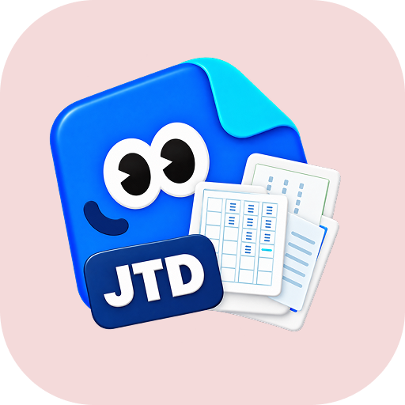
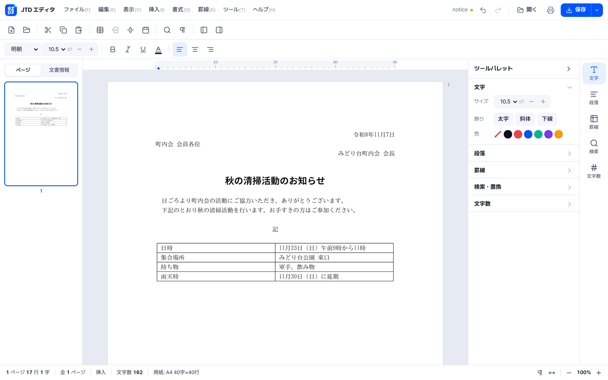
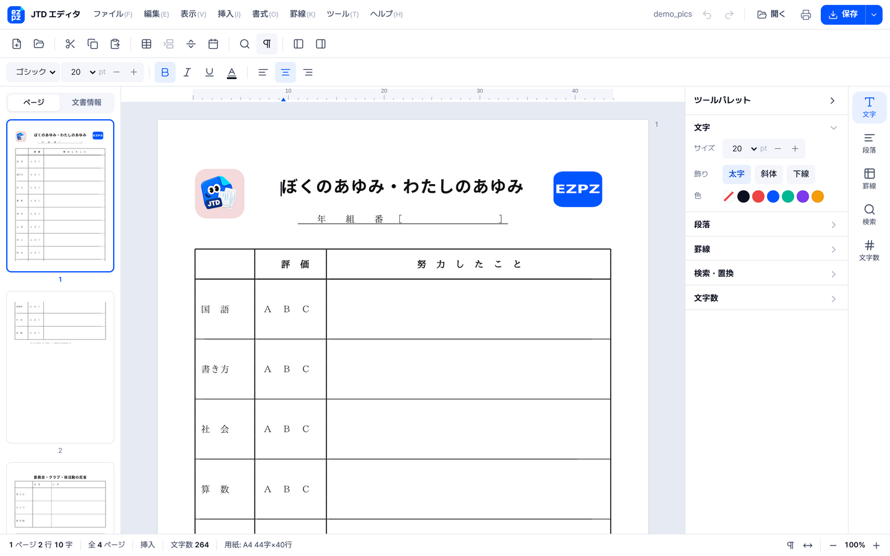
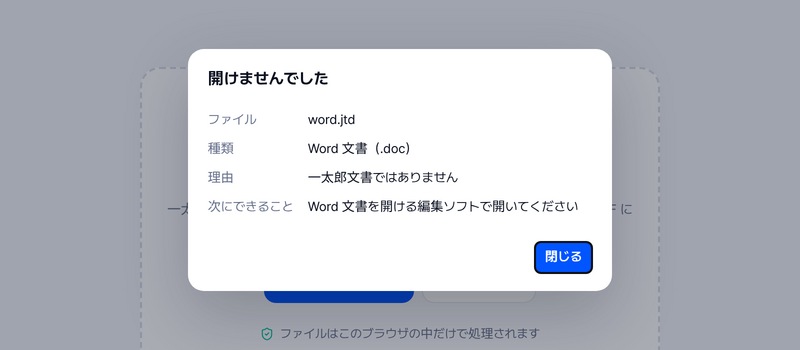
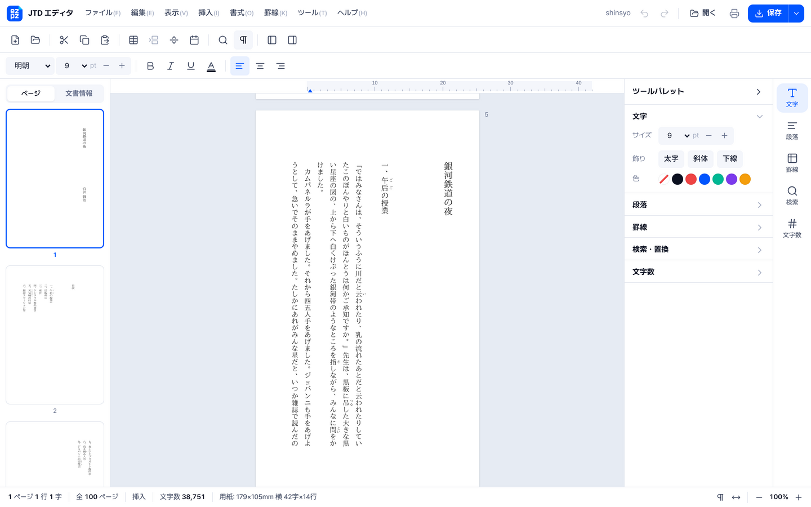

<p align="center">
  
</p>
<h1 align="center">EZPZ File JTD</h1>
<p align="center"><b>日本語</b> · <a href="README.en.md">English</a> · <a href="README.ko.md">한국어</a></p>
<p align="center">
  <a href="https://ezpzfile.com/ja/jtd-editor"></a>
</p>
<p align="center"><sub>デモ: <a href="https://ezpzfile.com/ja/jtd-editor">日本語</a> · <a href="https://ezpzfile.com/jtd-editor">English</a></sub></p>

**一太郎の `.jtd` 文書を、Mac・Linux・スマホ・ブラウザで開いて、直して、保存。**
ジャストシステム 一太郎のファイルを扱うための、オープンソースの読み込みエンジン・エディタ・ファイル形式仕様書です。
HWP における [rhwp](https://github.com/edwardkim/rhwp) と同じ考え方で作っています。ファイルは端末の外に送信されません。

状態: **v0.5.13。`.jtd` に保存し直せる読み込みエンジン + エディタ（開発者向けプレビュー）。**
株式会社ジャストシステムとは関係ありません。

[](https://ezpzfile.com/ja/jtd-editor)

<sub>架空の町内会のお知らせを、ブラウザのエディタで開いたところ（このエンジンで作った文書）。</sub>

<table>
<tr>
<td width="50%"><a href="https://ezpzfile.com/ja/jtd-editor"></a></td>
<td width="50%"><a href="https://ezpzfile.com/ja/jtd-editor"></a></td>
</tr>
<tr>
<td><sub><b>画像の表示（0.4.4）</b>：文書に貼られた写真やイラストを、一太郎ビューアと同じ位置に表示（画像は見本用に差し替え）</sub></td>
<td><sub><b>開けないファイルの案内（0.4.0）</b>：何のファイルか、なぜ開けないか、次にできることを表示</sub></td>
</tr>
<tr>
<td colspan="2"><a href="https://ezpzfile.com/ja/jtd-editor"></a></td>
</tr>
<tr>
<td colspan="2"><sub><b>縦書き（0.4.6）</b>：文芸書テンプレートの『銀河鉄道の夜』（宮沢賢治、パブリックドメイン）。ルビも縦書きの右側に表示</sub></td>
</tr>
</table>

### 最近の更新

| 版 | 内容 |
|---|---|
| 0.5.13 | 段落の途中に付いた図をその文字の行に合わせる。図形の線の色を輪郭ごとに読む（ヒイラギやステッキの黒い縁）、斜線の模様、細い線を見える太さで。文字枠の幅0の線（細線）を表示。文字枠の字数で行が途中で切れないように |
| 0.5.12 | 罫線の色、セルの網掛けと文字揃え、均等割付、文字枠の線（影・角丸・点線）と行間・字数、線なしの図形、木目などのテクスチャ図形、表の行に付いた図の位置、文字枠に押される空行を一太郎ビューアと同じに。文字は図形より上に表示 |
| 0.5.11 | ヘッダ・フッタ（柱）とページ番号を表示（位置・揃え・用紙端からの距離を一太郎ビューアと同じに）。小さな画像を拡大するときドットのまま表示 |
| 0.5.10 | 図形と枠の対応を順番で取る（大きさの合わない図形が抜けたり別の枠に入ったりしていた）。曲線の大きさを曲線そのものから計る |
| 0.5.9 | 図形の多角形（63xx）・直線・折れ線を描き、学校だよりの花やこいのぼり、人物の絵が出るように。ページの背景（色・画像）を表示。文字枠の線の有無・角の丸み・重なり順を一太郎ビューアに合わせる。用紙いっぱいの枠では本文が中に入る。大きな文字の字間を修正 |
| 0.5.8 | 横書きの学校だよりを縦書きと取り違えていた判定を直す（行事予定表が元どおり横に並ぶ）。横書きのページの縦書き文字枠を縦に描く。幅だけ書かれた用紙（A3横の卒業証書）を正しい大きさに。最後の空の行に付いた文字枠が消えていたのを直す |
| 0.5.7 | 縦組みの3段組（本文の先頭の段組記録から）を表示し、段の字数も一太郎ビューアと同じに。罫線で囲んだ題字の枠を描く。縦書き本文の写真・枠・図形は付いている文字の位置から置く。段組記録だけの空の行は高さを取らない |
| 0.5.6 | 縦組み文書の段（上下に積む）を表示。文字枠の書き方向（縦書き / 横書き）と文字サイズを読む（学校だよりの本文・題字が縦書きで、見出し枠は横書きのまま）。縦組みのページでは枠を用紙どおりに置く |
| 0.5.5 | 行数（`100D`）を後ろに行目印の一覧がある文書でも読む（学校の文書で 40 行に戻っていた）。縦組みの判定もれを修正。段組では 1 文字 = 文字サイズ × 1.031 のマスで、字数ぶんだけ並べる。半角文字は字間を足さない。`1014` の 2 ページ割付（A4 横に 2 ページ）を 2 ページとして表示 |
| 0.5.4 | ページに固定した枠を、その半分（またはページ）の最初から本文が避ける（2回並べて決める）。空の行は、行の上に置く図形を持つときだけ枠の下へ動く。文書の最初の段組レコードの行は高さを取らない。「。（」のような約物の連続は前の約物を半角に。学校のお知らせ2枚が一太郎ビューアとほぼ同じ配置に |
| 0.5.3 | B4 横の**上下に分かれた段組**（左上・右上・左下・右下の順に流れ、ページに固定した枠は上下それぞれの半分から測る）。空の行は枠を避けず、行全体をふさぐテキストボックスは本文を下へ送る。ルビ付きの行と 16pt の行が一行に収まる |
| 0.5.2 | テキストボックスの**影**（実線・点線）、**塗り**（単色・グラデーション）、内側の余白、行の間隔を一太郎ビューアに合わせた。行間と行数が大きく食い違う文書は行間に従う |
| 0.5.1 | テキストボックスの**枠線**（点線・実線・角丸）、図形の**網かけ**とグラデーション、テキストボックスの中に置かれた図形。本文は写真を避け、テキストボックスの横では幅を詰める（一太郎ビューアと同じ位置に）。**Word 書き出しに図形**（SVG） |
| 0.5.0 | **図形**（イラスト、吹き出し、楕円や角丸の枠、五線など）と、花子などほかのソフトで作った**飾り文字・絵**（OLE のプレビュー）を表示。B4 の 2 段組の学校だよりが一太郎ビューアに近い形に |
| 0.4.9 | 本文がテキストボックスや写真の**回り込み**に従って横を流れ、重ならないように。用紙に固定された枠は用紙の左上から配置 |
| 0.4.8 | **フォント**: 文書で使われているフォント名をそのまま一覧に出して選べ、そのフォントで `.jtd` に保存。丸ゴシック・教科書体・楷書体・ポップ体は似た無料フォントで表示。**テキストボックス**の文字、**段組**、行間の詰まった文書の行の高さ、罫線の行に置かれた画像を表示。**Word 書き出しに画像**とフォント名 |
| 0.4.7 | 韓国語など、入力モード中にキーがすべて IME 扱いになる入力方式で、Backspace・Delete・矢印キーが効かず、字母がばらばらになる問題を修正。ツールパレットを整理し、ボタンが折り返さないように |
| 0.4.6 | **縦書き**の文書を縦書きで表示・編集（文字は正立、、。は右上、長音やかっこは回転）。Word 書き出しも縦書き |
| 0.4.5 | 画像の横に出ていた小さな記号を表示しないように。README の画面を更新 |
| 0.4.4 | 文書に貼られた画像（GIF・JPEG・PNG・BMP）を元の位置に表示。PDF 書き出しにも入る |
| 0.4.3 | 圧縮文書 `.jtdc` を開く画面で選べるように。実物 17 件で確認 |
| 0.4.2 | 明朝・ゴシックを選んで `.jtd` に保存 |
| 0.4.1 | 罫線の枠の直前の改ページを含む文書を `.jtd` に保存できるように |
| 0.4.0 | 圧縮された一太郎文書（`.jttc`・`.jtdc`）を開く、開けないファイルの案内、ゴシック体の表示 |

すべての変更は [Releases](https://github.com/ezpzfile/ezpzfile-jtd/releases) を参照。

## ブラウザでそのまま使う（インストール不要）

このエンジンをそのまま組み込んだ無料ツールを公開しています。ファイルは端末の外に送信されません。

- [JTD エディタ](https://ezpzfile.com/ja/jtd-editor)：.jtd を開いて直し、一太郎形式のまま保存。Word・PDF にも変換
- [jtd ファイルの開き方（一太郎なし）](https://ezpzfile.com/ja/column/open-jtd-file)
- [一太郎を PDF に変換する](https://ezpzfile.com/ja/column/ichitaro-to-pdf)
- [一太郎ビューアが使えないときの代わり](https://ezpzfile.com/ja/column/ichitaro-viewer-alternative)

### このエンジンを使っているサイト

- [KUKAN](https://github.com/kukan-project/kukan)：官公庁のオープンデータカタログ。一太郎文書のプレビューに利用
- [openedfile.com](https://openedfile.com/ja/tools/jtd)：jtd をブラウザで開く・変換するツール

採用例があればお知らせください。ここに追記します。

## できること

官公庁などがインターネットで公開している一太郎ファイルで確認しています（一太郎 8 から最新版まで。95 件の基本セットと、画像・縦書き・大きな文書などを含む 111 件の追加セット）。

**開く**

- 95 件の基本セットはすべて開く。1 ファイルあたり約 2 ms
- 本文: 見える文字の 99.9 % が **一太郎ビューアそのもの** の表示と一致（94 件中 87 件は完全一致）。
  ジャストシステムの無料ビューアで自動的に確認
- **圧縮された一太郎文書**（`.jttc` 圧縮テンプレート、`.jtdc` 圧縮文書）: 中の文書を展開して開く（LHA の `-lh5-` 方式）。
  公開されている実物 17 件がすべて開き、`.jtdc` の本文は一太郎ビューアと 99.2 % 一致
- 100 ページ前後の大きな文書（本文が複数の断片に分かれた形式）も開いて、`.jtd` に保存できる
- 開けないファイルの判定: Word・PDF・RTF・テキストなど、何のファイルかを返す（`sniff::kind`、WASM `fileKind`）。
  `.jtd` という名前の RTF やテキストは、エディタが文字だけを新規文書として開く

**表示する**

- 段落と揃え、インデント、改行幅
- 罫線の表（結合セル、列幅、縦罫線と**横罫線**、行間罫線・通常罫線、**線種**: 太線・点線・二重線など 16 種）
- 文書スタイル: **用紙サイズと向き、余白、字数・行数**、標準の文字サイズ
- 文字サイズ、太字、斜体、下線、文字色、ルビ、改ページ
- 書体: 明朝、ゴシック、丸ゴシック、教科書体、楷書体、ポップ体（文書のフォント名から判断。ezpzfile.com では似た無料フォントで表示）
- **縦書き**（縦組み）: 行は上から下へ、右から左へ。漢字・かなは正立、、。は右上、長音・かっこ・半角文字は回転。矢印キーも縦書きの向きで動く
- **画像**: 文書に貼られた GIF・JPEG・PNG・BMP をページの元の位置に表示（`/Frame` の枠と本文のアンカー、一太郎ビューアと照合）
- 文書情報。一太郎がファイルの中に残す **元の保存場所（パス）** も表示

**直して保存する**

- 編集したファイルを **`.jtd` に保存し直せ**、一太郎ビューアで開ける（下記参照）。画像も残る
- 文書のフォント（とＭＳ 明朝・HG丸ｺﾞｼｯｸM-PRO などよく使うもの）を選んで `.jtd` に保存。一太郎ビューアで確認
- テキストボックスの文字、段組、罫線の行に置かれた画像を表示
- 書き出し: Word（`.docx`）、PDF、HTML、テキスト、Markdown、JSON

**まだできないこと**: 図形とテキストボックスの編集、テキストボックスの向き（縦書きの箱）、ヘッダ・フッタ、
一太郎 Ver.7 以前の形式（`.jaw` `.jbw` など）。詳しくは [企画書](docs/PLAN.ja.md)（[English](docs/PLAN.en.md)、[한국어](docs/PLAN.ko.md)）を参照。

## エディタ

`web/dist/ezpzjtd-editor.html` は 1 ファイルで完結したワープロです。ダブルクリックで開き、`.jtd` を
ウィンドウにドロップして（または新規文書から）編集し、**一太郎（.jtd）**・Word・PDF・HTML・テキストで
保存します。rhwp-studio と同じく、ページの配置と描画はエンジンが自分で行います（canvas）。ブラウザが
受け持つのはキー入力、日本語入力（IME）、画面だけです。

画面とキー操作は一太郎に合わせているので、一太郎の利用者はすぐに使えます。罫線メニューのあるメニューバー、
ツールバー、左のジャンプパレット（ページ、文書情報）、右のツールパレット、字単位のルーラ、`nページ n行 n字`
と 挿入/上書 のステータスバー、編集記号（改行マーク、全角スペースの □）、一太郎のショートカット
（Ctrl+5/6 センタリング/右寄せ、Ctrl+↑/↓ 文字サイズ、Ctrl+Y 改ページ、Ctrl+¥ 表、F7 フォント、
Ctrl+2 名前を付けて保存、Esc メニュー、Ctrl+F の Windows 型 / 一太郎型の切り替え）。
ジャストシステムの画像やアイコンは使っていません。
画面の言葉は日本語と英語があります。英語版は `web/dist/ezpzjtd-editor.en.html` で、どちらのファイルも
`?lang=en` / `?lang=ja` で切り替えられます。ブラウザですぐ使うなら [ezpzfile.com/ja/jtd-editor](https://ezpzfile.com/ja/jtd-editor)。
ほかのサイトに載せるときは `web/dist/ezpzjtd-editor.embed.html` に `web/pkg/` の `.wasm` の URL を入れて使います。
同じサイトのページの枠（iframe）の中で開くと、`web/editor/host.js` の決まりでそのページとやり取りします。
詳しくは [docs/EDITOR.ja.md](docs/EDITOR.ja.md)（[English](docs/EDITOR.en.md)、[한국어](docs/EDITOR.ko.md)）。

### `.jtd` で保存

`.jtd` から開いた文書は `.jtd` に保存し直せます（Ctrl+S）。エンジンはファイルを作り直さず、
**元のファイルを書き換えます**。そのため、まだ解読していない部分（罫線の座標、隠しフィールド、マクロ、図）は
1 バイトも変わりません。書き換えるのは文字、段落、太字・斜体・サイズ・下線・色、揃え、インデント・改行幅、改ページ、
表の行です（新しい行は元の行の線種を引き継ぎます）。
保存のたびに結果を読み直してエディタの内容と比べ、違いがあれば理由を表示して保存を取りやめます
（何も書き込みません。その場合は Word か PDF で保存してください）。

**新規文書**も `.jtd` で保存できます。一太郎の新規文書と同じページ（A4、余白 30 mm、40 字 × 40 行、10.5 pt）の
空の一太郎ファイル（`engine/crates/ezpzjtd-core/src/blank.jtd`）に書き込みます。この空ファイルは公開されている
一太郎ファイルから本文、作成者、日時、元の保存場所を取り除いて作りました（作り方は `examples/makeblank.rs`）。
新規文書で入力した文字・書式・表・改ページが一太郎ビューアで開けることを確かめています。

確認には、ジャストシステムの一太郎ビューア 2022 を Wine で自動実行しています
（[tools/taroview](tools/taroview/README.md)）。結果は [experiments/results.md](experiments/results.md)（韓国語）。
さらに **一太郎 最新版の本体**（Wine で実行、[tools/taro2026](tools/taro2026/README.md)）でも確認しています。
エディタで編集して保存したファイル 274 件はすべて一太郎 最新版で開けました。新しく作った表も、一太郎で作った表と同じように
縦罫線・横罫線が描かれます。詳しくは [docs/research/ichitaro-latest.md](docs/research/ichitaro-latest.md)（英語）。

### PDF

PDF 保存では、ページを画面に描いたとおりに書き出し、見えない文字層を重ねます。そのため PDF でも
文字の検索・コピーができます。

## 使ってみる

**ブラウザ（インストール不要）:** 一度ビルドしてから `web/dist/ezpzjtd-editor.html`（エディタ）または
`web/dist/ezpzjtd-viewer.html`（ビューア）をダブルクリックし、`.jtd` ファイルをドロップします。
どちらもオフラインで動きます。

```sh
./web/build.sh
```

**コマンドライン:**

```sh
cd engine
cargo run --release -p ezpzjtd-cli -- text  sample.jtd      # テキスト
cargo run --release -p ezpzjtd-cli -- html  sample.jtd > sample.html
cargo run --release -p ezpzjtd-cli -- md    sample.jtd      # Markdown
cargo run --release -p ezpzjtd-cli -- json  sample.jtd      # 文書モデル
cargo run --release -p ezpzjtd-cli -- info  sample.jtd      # 文書情報、フォント、シート
```

ほかに `ezpzjtd docx <file> <out.docx>`。解析用のコマンド: `streams`、`dump <path>`、`tokens`、`styles`、
`experiment <file> <dir>`（一太郎ビューアで確かめるための変形ファイルを作る）。

**ライブラリとして（Rust）:**

```rust
let doc = ezpzjtd_core::open(std::fs::read("sample.jtd")?)?;
println!("{}", doc.plain_text());
let html = ezpzjtd_core::export::to_html(&doc);
```

**ライブラリとして（JavaScript / WebAssembly）:** `./web/build.sh` のあとの `web/pkg/`。

```js
import init, { JtdDocument } from "./pkg/ezpzjtd_wasm.js";
await init();
const doc = new JtdDocument(new Uint8Array(await file.arrayBuffer()));
element.innerHTML = doc.html();
```

### 信頼できないファイルを開くとき

`.jtd` はファイルの中に長さや個数の欄を持っています。細工されたファイルが実際より大きな値を書いていても、
エンジンはそれをそのまま信じず、実際にあるバイト数と次の上限で止めます（既定値は実在の文書よりずっと大きい値です）。

| 上限 | 既定値 | 超えたとき |
|---|---|---|
| `maxBytes` | 256 MB | 「too large or damaged」エラー |
| `maxTextUnits` | 800 万字 | 同上 |
| `maxExpand` | ファイルの 4 倍 | 本文ストリームの合計がこれを超えると同上 |
| `maxStyleEntries` | 200 万 | 文字書式の切り替えで保持する属性の総数がこれを超えると同上（0.3.3） |
| `maxSheets` | 64 | それ以降のシートは読まず警告 |
| `maxPages` | 2,000 | そこでレイアウトを止める（`statusJson().truncated`） |

他のサービスに組み込む場合は、上限を下げて Web Worker の中で動かすのがおすすめです。
`web/worker/ezpzjtd-safe.js` がそのまま使えます（時間切れのときは Worker ごと止めます）。

```js
import { readJtdSafely } from "./worker/ezpzjtd-safe.js";
const { result } = await readJtdSafely(bytes, { want: "html", limits: { maxPages: 300 }, timeoutMs: 10000 });
// または直接: JtdDocument.withLimits(bytes, '{"maxPages":300}') / JtdEditor.openWith(bytes, '{"maxPages":300}')
```

Rust では `ezpzjtd_core::open_with(bytes, &Limits { max_pages: 300, ..Default::default() })`。

## ファイル形式

[`docs/spec/JTD-FORMAT.md`](docs/spec/JTD-FORMAT.md)（英語）が作業中の仕様書です。
すべての記述に *confirmed / strong / observed / candidate / unknown* の確からしさを付けています。

一太郎なしで解読する方法: 官公庁は同じ様式を `.jtd` **と** `.doc` の両方で公開することがよくあります。
Word 側の書式はわかっているので、2 つのファイルを 1 文字ずつ突き合わせれば、jtd の未知の項目の意味がわかります。
そのためのスクリプトは `tools/research/` にあります。

v0.3 からは **ジャストシステムの無料の一太郎ビューアを審判** にしています。変更したファイルを本物のビューア
（Wine、日本語環境）で開き、表示された文字をコピーして比べます。この方法で、格納庫ごとのストリーム一覧
（`\x04JSRV_SegmentInformation`）がすべてのストリームのサイズと一致していなければならないことを見つけました。

## リポジトリの構成

```
engine/                Rust のワークスペース
  crates/ezpzjtd-core    読み込み（CFB → ブロック格納庫 → レコード → 書式 → モデル）、
                       編集（編集、字×行の格子への配置）、書き出し（docx, pdf, html, md）、
                       保存（save.rs: 元のファイルの書き換え、cfbw.rs: CFB の書き込み）
  crates/ezpzjtd-cli     `ezpzjtd` コマンド
  crates/ezpzjtd-wasm    WebAssembly バインディング
web/                   ブラウザのエディタ（editor.html + editor/app.js）とビューア。1 ファイルにビルド
docs/spec/             ファイル形式の仕様書（英語）
docs/PLAN.*.md         企画書、docs/EDITOR.*.md エディタ設計（日本語、English、한국어）
docs/research/         研究メモ、サンプル作りの手引き
tools/                 コーパスのダウンロードと解析用スクリプト
tools/taroview/        本物の一太郎ビューア（Wine）でファイルを開き、表示内容を読み取る
tools/taro2026/        一太郎 最新版（Wine）で対になるサンプルを作り、保存したファイルを開いて確かめる
experiments/           ビューアでの確認の記録と結果
corpus/manifest.tsv    公開サンプルファイルの URL（ファイル自体はコミットしない）
```

## 協力のお願い

いちばん助かるのは **対になるサンプル** です。一太郎で同じ文書を、設定を 1 つだけ変えて 2 回保存したものです。
作り方は [`docs/research/paired-samples.ja.md`](docs/research/paired-samples.ja.md) を参照してください。
共有する権利のない文書はコミットしないでください。

```sh
python3 tools/fetch_corpus.py --docx   # 公開コーパス → corpus/local/
cd engine && EZPZJTD_CORPUS=$PWD/../corpus/local cargo test
```

## 謝辞

[OpenJTD](https://github.com/KimEJ/OpenJTD) と [Tika-JTD](https://github.com/KHiyowa/Tika-JTD) の
公開研究をもとにしています。[NOTICE](NOTICE) を参照してください。

0.3.2 と 0.3.3 のメモリ使用の問題（細工されたファイルでメモリとページ数が増え続ける、書式の属性が切り替えや文字ごとに複製される）は、
[KUKAN](https://github.com/kukan-project/kukan) の HIDANO Masaki さんから非公開でご報告いただき修正しました。ありがとうございました。

## ライセンス

MIT ライセンス（[LICENSE](LICENSE)）。使用・改変・再配布・商用利用は自由です。コピーや改変版には、
著作権表示「Copyright (c) 2026 EZPZ File (https://ezpzfile.com)」とライセンス文をそのまま残してください。
サービスや製品で使うときに、どこかに「Powered by EZPZ File」と表示していただけるとうれしいです（任意）。
「一太郎」は株式会社ジャストシステムの商標です。
